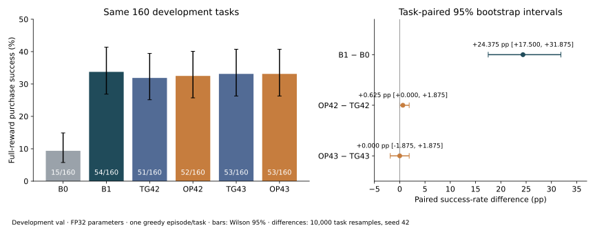

# 展示统计与动作案例交接

适用已登记的六组完整160项开发验证，实际执行a424a890。每组同一冻结160项、贪心、参数FP32、最多10决策，正常策略失败保留分母。 [登记与统计口径](README.md)

左图为每组160项的满分购买成功率和Wilson 95%区间。右图为目标减基线的任务配对差，10,000次重采样、seed42、冻结任务顺序及线性分位数。B1减B0为+24.375pp [17.5,31.875]，OP42减TG42为+0.625pp [0,1.875]，OP43减TG43为0pp [−1.875,1.875]。seed42区间含0端点，不能写为严格大于0。两训练种子分别报告，仍是同一160项任务。

## 改善案例，任务5604，seed42

两臂先执行相同搜索并打开相同商品。TG直接购买，得2/3分；OP先点击可用口味watermelon，再选5oz，随后购买得1分。TG三步、OP五步，均无无效动作。这是该任务观测到的规格选择差异。

建议英文讲述为 “Both agents opened the same product. TG bought it immediately and scored two thirds. OP selected the requested options before buying and received full reward.”

## 退步案例，任务4360，seed43

两臂先执行同一搜索、打开同一商品并选择相同尺寸，随后都提交了当页不可用的click[color]。TG接着点击实际可用的black并购买，六步后得1分；OP之后连续六次未通过动作格式解析，达到十步上限且未购买。OP最后页面匹配分仍为1，但终局任务奖励为0。

建议英文讲述为 “Both agents made the same invalid click. TG recovered by selecting black and buying. OP then produced six unparsable responses and reached the step limit without purchasing.”

seed43另一个任务411中OP多一次满分成功，4360少一次，因此两臂满分总数相同仍伴随逐任务变化。两个案例用于解释行为，未据此推断奖励方案的总体因果效果。

## 原始证据入口

[私有完整证据包](https://github.com/Zqqq-qq/webshop-stepwise-rl/releases/download/data-v1/webshop-project-fp32-full160-training-evidence-20261123.zip)，SHA-256 4ea38266297bdc5d70e1da5818851532d092c75503412a75772615b302fe797b。

改善案例在tg42/rollout.jsonl、op42/rollout.jsonl中按task_id=5604定位；退步案例在tg43/rollout.jsonl、op43/rollout.jsonl中按task_id=4360定位。引用原始任务内容/页面时沿用私有共享渠道。此文只保留动作与评分摘要。

PPT第二版1b58912e的第6页与notes中的六组计数和以上配对区间均核对一致。第7页训练总量为16更新/64回合，完整开发验证已完成。保留test仍待共同门禁。
